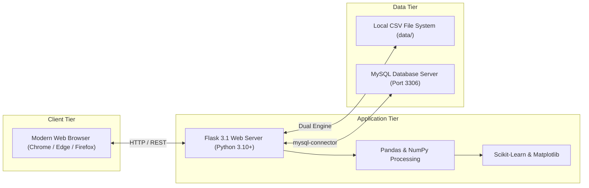
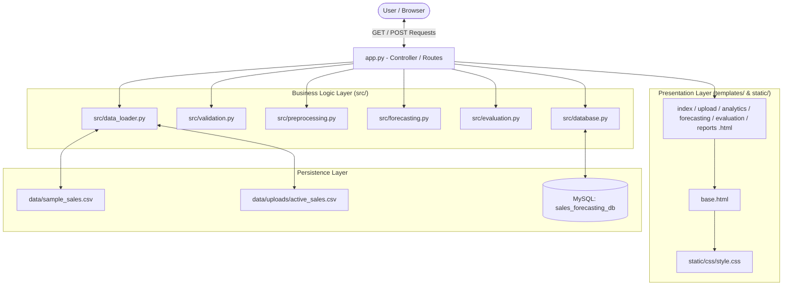
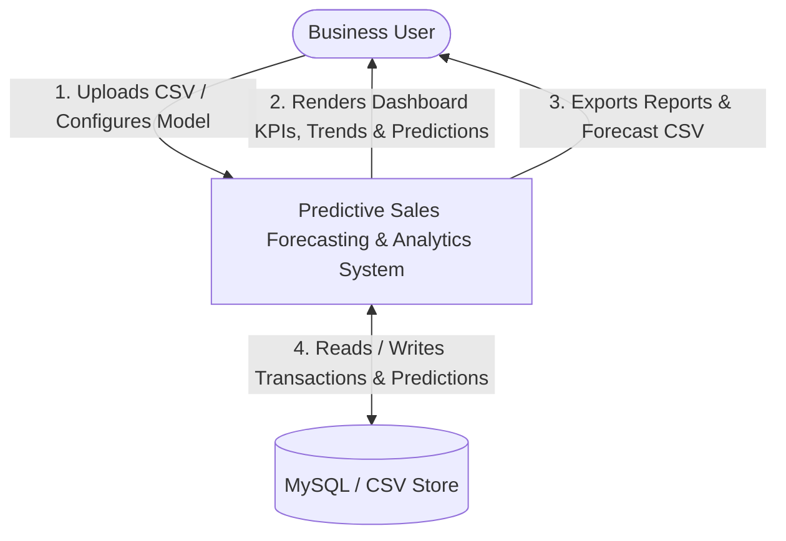
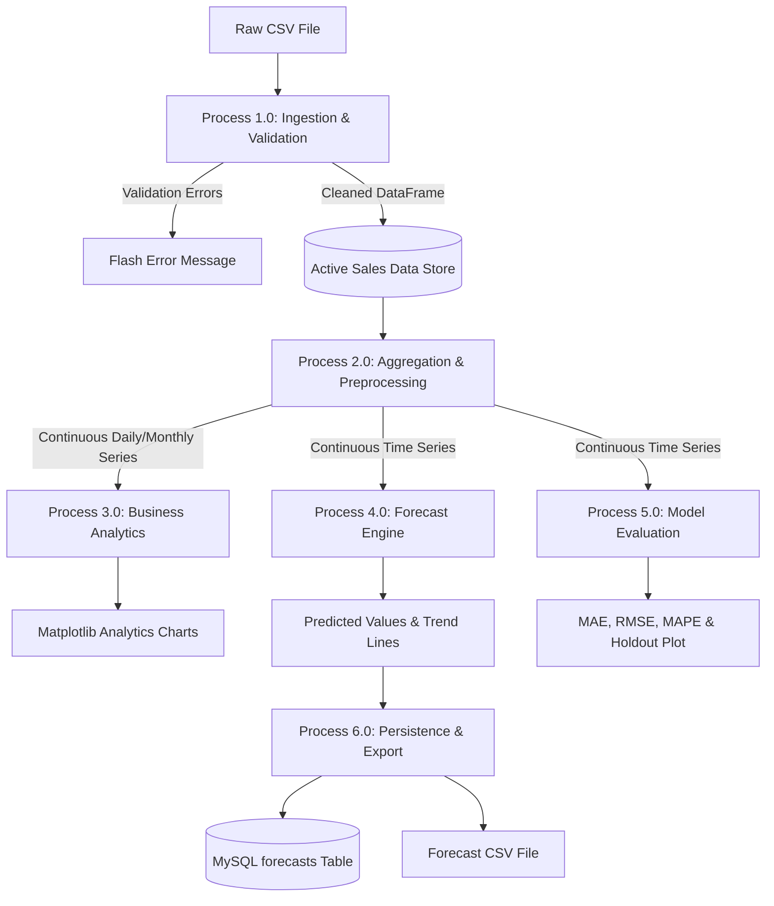
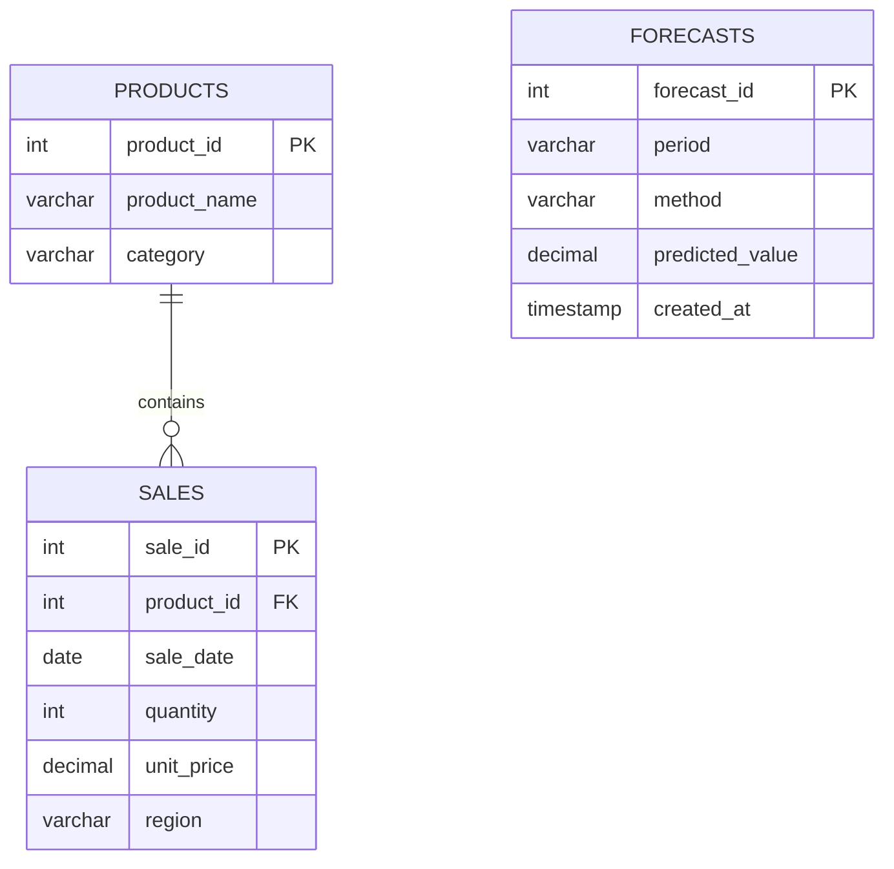
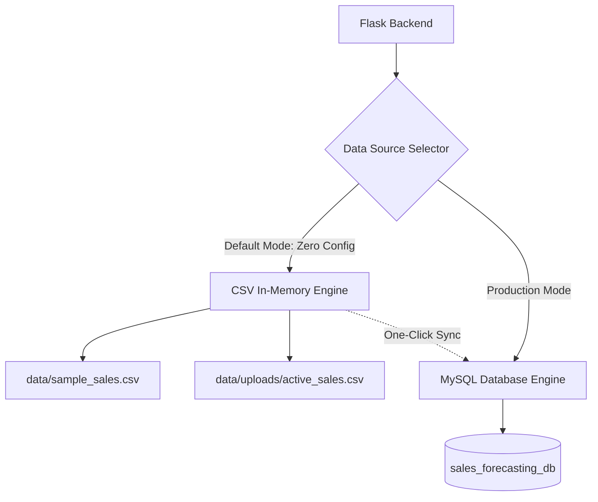

# 📘 PROJECT DOCUMENTATION & TECHNICAL REPORT
## Predictive Sales Forecasting and Business Analytics System

---

**Academic Project Information**
- **Project Title:** Predictive Sales Forecasting and Business Analytics System
- **Project Category:** Capstone Web Application & Business Intelligence (BI) Platform
- **Degree / Branch:** Bachelor of Technology (B.Tech) in Computer Science & Engineering (CSE)
- **Academic Year:** Second Year Major Project
- **Technology Stack:** Python 3, Flask, Pandas, NumPy, Matplotlib, Scikit-learn, MySQL, HTML5, CSS3

---

## TABLE OF CONTENTS
1. [Executive Summary / Abstract](#1-executive-summary--abstract)
2. [Introduction & Problem Statement](#2-introduction--problem-statement)
3. [Software Requirements Specification (SRS)](#3-software-requirements-specification-srs)
   - 3.1 Functional Requirements
   - 3.2 Non-Functional Requirements
   - 3.3 Hardware and Software Environment
4. [System Architecture & Design](#4-system-architecture--design)
   - 4.1 High-Level Architecture Diagram
   - 4.2 Modular Component Design
   - 4.3 Data Flow Diagrams (DFD Level 0 & Level 1)
   - 4.4 Entity-Relationship (ER) Diagram
   - 4.5 Database Data Dictionary
5. [Mathematical Formulations & Algorithmic Theory](#5-mathematical-formulations--algorithmic-theory)
   - 5.1 Revenue Calculation
   - 5.2 Simple Moving Average (SMA) Baseline
   - 5.3 Ordinary Least Squares (OLS) Linear Regression
   - 5.4 Error Evaluation Metrics (MAE, RMSE, MAPE)
   - 5.5 Critical Principle: Chronological Holdout Split vs. Random Shuffling
6. [Implementation Details & Module Directory](#6-implementation-details--module-directory)
   - 6.1 Backend Modular Structure
   - 6.2 Dual-Engine Storage Architecture (CSV & MySQL)
   - 6.3 Frontend Page Hierarchy
   - 6.4 Web Routing & API Endpoints
7. [Testing, Verification & Quality Assurance](#7-testing-verification--quality-assurance)
   - 7.1 Test Strategy & Methodology
   - 7.2 Automated Test Suite Breakdown
   - 7.3 Test Case Execution Matrix
8. [Installation & Windows Operating Manual](#8-installation--windows-operating-manual)
   - 8.1 Setup Instructions
   - 8.2 Operational Walkthrough
   - 8.3 MySQL Database Initialization & Sync
9. [College Viva Voce & Oral Defense Q&A](#9-college-viva-voce--oral-defense-qa)
10. [Assumptions, Limitations & Future Scope](#10-assumptions-limitations--future-scope)

---

## 1. Executive Summary / Abstract

In contemporary enterprise resource planning (ERP) and retail operations, proactive inventory management and financial capital allocation depend fundamentally on precise demand anticipation. Traditional static spreadsheets lack real-time predictive capabilities, multi-period error tracking, and automated validation against corrupt transaction records.

This project presents the **Predictive Sales Forecasting and Business Analytics System**, an integrated, full-stack web application designed to bridge historical business data analysis with forward-looking predictive modeling. Built using Python, Flask, Pandas, Matplotlib, Scikit-learn, and MySQL, the system ingests raw sales transaction logs, performs multi-level data integrity validation, extracts multi-dimensional business intelligence, computes future revenue trajectories via baseline and regression models, and performs rigorous chronological holdout validation.

The system features a **Dual-Engine Architecture**: it operates completely out-of-the-box using an in-memory CSV engine backed by a realistic 616-record retail dataset, while simultaneously providing complete schema definitions, connection health monitoring, and one-click data synchronization for enterprise MySQL relational databases.

---

## 2. Introduction & Problem Statement

### 2.1 Background
Retail organizations accumulate substantial volumes of transactional data comprising order timestamps, product identifiers, unit pricing, quantities, categories, and geographic territories. However, raw transactional records do not directly yield actionable decision support without automated aggregation, visual velocity tracking, and trend extrapolation.

### 2.2 Problem Statement
Small-to-medium retail businesses and academic analysts frequently encounter three primary bottlenecks:
1. **Data Ingestion Vulnerabilities**: Inconsistent CSV uploads with missing columns, negative quantities, negative prices, or unparseable timestamps crash analytical scripts.
2. **Methodological Errors in Time-Series Machine Learning**: Developers commonly commit *data leakage* (lookahead bias) by randomly shuffling time-dependent datasets during train/test splits.
3. **Decoupled Analytics and Modeling**: Organizations use disjoint tools for historical reporting (e.g., standard BI dashboards) and forecasting (isolated Jupyter notebooks), preventing seamless decision-making.

### 2.3 Proposed Solution
The application provides an end-to-end, unified platform structured into six interconnected modules:
- Real-time Executive KPI Dashboard
- Defensive CSV Data Upload & Validation Engine
- Business Intelligence & Market Share Analytics
- Predictive Sales Forecasting (Moving Average & Scikit-learn Linear Regression)
- Scientifically Valid Chronological Holdout Evaluation
- Executive Audit Reporting with PDF Printing and CSV Export

---

## 3. Software Requirements Specification (SRS)

### 3.1 Functional Requirements

| Requirement ID | Module | Description |
| :--- | :--- | :--- |
| **FR-01** | Data Ingestion | Accept `.csv` file uploads containing transaction records. |
| **FR-02** | Data Validation | Validate schema for required columns (`sale_date`, `product_name`, `quantity`, `unit_price`), assert positive numeric values, and parse variable date formats. |
| **FR-03** | Error Reporting | Present actionable error alerts if data fails validation without crashing the application server. |
| **FR-04** | Dataset Preview | Render a tabular preview of the first 15 active records with automatic revenue computation. |
| **FR-05** | Executive Dashboard | Display 4 primary KPI cards (Total Revenue, Total Quantity Sold, Active Products, Total Records), sales trend velocity chart, and latest forecast summary. |
| **FR-06** | Granular Analytics | Provide daily and monthly aggregation toggles, product rankings, category shares, and regional distributions. |
| **FR-07** | Baseline Forecasting | Implement Simple Moving Average (SMA) with configurable window sizes (3, 7, 14, 30) and multi-step future projection. |
| **FR-08** | Trend Forecasting | Implement Ordinary Least Squares Linear Regression via Scikit-learn, calculating slope, intercept, and $R^2$ score. |
| **FR-09** | Holdout Evaluation | Partition data chronologically (e.g., 80% train, 20% test) without shuffling. Compute MAE, RMSE, and MAPE metrics on identical test windows. |
| **FR-10** | Model Comparison | Automatically determine the winning model based on MAE and generate natural language interpretations. |
| **FR-11** | Report Generation | Compile executive summary reports with printable layout (`@media print`) and export forecast predictions to CSV. |
| **FR-12** | Database Sync | Provide schema creation, connection health checks, record loading, and forecast persistence for MySQL databases. |

### 3.2 Non-Functional Requirements
- **Performance:** Sub-second response times for aggregations and visualizations through in-memory caching and headless Matplotlib rendering.
- **Reliability & Fault Tolerance:** Non-blocking database connection checks utilizing lightweight socket timeouts (0.3s) and status caching, ensuring the application operates seamlessly even when MySQL is offline.
- **Usability:** Responsive, modern CSS layout featuring card hierarchies, metric callouts, and clean typographic contrast suitable for executive presentations.
- **Data Integrity:** Strict non-negative constraints enforced on quantities, prices, and projected revenues ($\hat{y} \ge 0$).

### 3.3 Hardware and Software Environment



- **Operating System:** Windows 10 / 11, Linux, or macOS
- **Runtime Environment:** Python 3.10 to Python 3.13
- **Primary Libraries:** Flask 3.1+, Pandas 2.2+, NumPy 1.26+, Matplotlib 3.8+, Scikit-learn 1.4+, mysql-connector-python 8.0+
- **Database Engine (Optional):** MySQL Server 8.0+ or MariaDB 10.4+

---

## 4. System Architecture & Design

### 4.1 High-Level Architecture

The system adheres to the classic **Model-View-Controller (MVC)** architectural pattern adapted for Flask:



### 4.2 Modular Component Design
1. **`src/validation.py`**: Defensive data barrier. Performs case-insensitive column aliasing, data type verification, negative number filtering, and date coercion.
2. **`src/preprocessing.py`**: Aggregates raw transactional events into regular time series (`'D'` for daily, `'M'` for monthly). Reindexes across the full date span to impute zero-sale days, preventing temporal gaps.
3. **`src/forecasting.py`**: Computes multi-step Simple Moving Average projections and Ordinary Least Squares Linear Regression models. Encodes Matplotlib figures into base64 strings for zero-dependency HTML rendering.
4. **`src/evaluation.py`**: Partitions time-series chronologically into training and testing windows, computes MAE, RMSE, and MAPE, and renders comparative holdout plots.
5. **`src/database.py`**: Implements socket-level pre-checks, connection pools, schema initialization, table creation, product upserting, sales inserting, and forecast result persistence.
6. **`src/data_loader.py`**: Acts as a state mediator managing active dataset references across sessions and synchronizing between disk and MySQL.

### 4.3 Data Flow Diagrams (DFD)

#### Level 0 DFD (Context Diagram)


#### Level 1 DFD (System Processes)


### 4.4 Entity-Relationship (ER) Diagram



### 4.5 Database Data Dictionary

#### 1. Table: `products`
Stores unique catalog items and their categorizations.
| Field | Data Type | Constraints | Description |
| :--- | :--- | :--- | :--- |
| `product_id` | `INT` | PRIMARY KEY | Unique identifier for product SKU. |
| `product_name` | `VARCHAR(255)` | NOT NULL | Human-readable title of product. |
| `category` | `VARCHAR(100)` | DEFAULT 'General' | Department classification. |

#### 2. Table: `sales`
Stores individual transaction line items.
| Field | Data Type | Constraints | Description |
| :--- | :--- | :--- | :--- |
| `sale_id` | `INT` | AUTO_INCREMENT, PRIMARY KEY | Unique transactional receipt identifier. |
| `product_id` | `INT` | NOT NULL, FOREIGN KEY | References `products(product_id)`. |
| `sale_date` | `DATE` | NOT NULL, INDEXED | Calendar date transaction took place. |
| `quantity` | `INT` | NOT NULL, CHECK (>0) | Number of units purchased. |
| `unit_price` | `DECIMAL(10,2)` | NOT NULL, CHECK (>0) | Unit price at time of sale. |
| `region` | `VARCHAR(100)` | DEFAULT 'Default' | Geographic distribution area. |

#### 3. Table: `forecasts`
Stores audit records of predictive projections.
| Field | Data Type | Constraints | Description |
| :--- | :--- | :--- | :--- |
| `forecast_id` | `INT` | AUTO_INCREMENT, PRIMARY KEY | Record entry identifier. |
| `period` | `VARCHAR(50)` | NOT NULL | Future date or calendar interval. |
| `method` | `VARCHAR(50)` | NOT NULL | Algorithm used ('Moving Average' / 'Linear Regression'). |
| `predicted_value`| `DECIMAL(10,2)` | NOT NULL | Projected sales revenue in dollars. |
| `created_at` | `TIMESTAMP` | DEFAULT CURRENT_TIMESTAMP | Timestamp when prediction was executed. |

---

## 5. Mathematical Formulations & Algorithmic Theory

### 5.1 Revenue Calculation
For any transactional record $i$:
$$\text{Revenue}_i = \text{Quantity}_i \times \text{Unit Price}_i$$

### 5.2 Simple Moving Average (SMA) Baseline
The Simple Moving Average operates as an unweighted rolling mean of the preceding $W$ historical periods.

#### Historical Smoothing:
For period $t \ge W$:
$$\hat{y}_t = \frac{1}{W} \sum_{i=1}^{W} y_{t-i}$$

#### Multi-Step Future Projection:
To extrapolate $H$ steps into the future, the algorithm iteratively treats newly predicted values as inputs for subsequent windows:
$$\hat{y}_{N+k} = \frac{1}{W} \sum_{j=1}^{W} z_{N+k-j}$$
where:
$$z_m = \begin{cases} y_m & \text{if } m \le N \text{ (historical actual)} \\ \hat{y}_m & \text{if } m > N \text{ (earlier forecast)} \end{cases}$$

### 5.3 Ordinary Least Squares (OLS) Linear Regression
Linear regression models the relationship between time indices $t \in \{0, 1, \dots, N-1\}$ and aggregated sales revenue $y$:
$$\hat{y}_t = m \cdot t + c$$

#### Derivation of Parameters:
The slope ($m$) and intercept ($c$) minimize the sum of squared residuals:
$$m = \frac{\sum_{i=0}^{N-1} (t_i - \bar{t})(y_i - \bar{y})}{\sum_{i=0}^{N-1} (t_i - \bar{t})^2}$$
$$c = \bar{y} - m \cdot \bar{t}$$

#### Coefficient of Determination ($R^2$):
Measures the proportion of variance explained by the linear trend:
$$R^2 = 1 - \frac{\sum_{i=0}^{N-1} (y_i - \hat{y}_i)^2}{\sum_{i=0}^{N-1} (y_i - \bar{y})^2}$$

#### Non-Negativity Constraint:
Because retail sales cannot physically assume negative values:
$$\hat{y}_{\text{final}} = \max(0, \hat{y}_t)$$

### 5.4 Error Evaluation Metrics

| Metric | Formula | Business Interpretation |
| :--- | :---: | :--- |
| **Mean Absolute Error (MAE)** | $\text{MAE} = \frac{1}{n} \sum_{t=1}^{n} \|y_t - \hat{y}_t\|$ | The average absolute error in dollar terms. An MAE of \$50 indicates that predictions are off by \$50 on average. |
| **Root Mean Squared Error (RMSE)** | $\text{RMSE} = \sqrt{\frac{1}{n} \sum_{t=1}^{n} (y_t - \hat{y}_t)^2}$ | Penalizes large outlier errors heavily due to squaring. Substantial difference between RMSE and MAE indicates volatile forecast spikes. |
| **Mean Absolute Percentage Error (MAPE)** | $\text{MAPE} = \frac{100\%}{n} \sum_{t=1}^{n} \left\| \frac{y_t - \hat{y}_t}{y_t} \right\|$ | Normalizes error relative to sales volume as a percentage, enabling comparisons across products of different scales. |

### 5.5 Critical Principle: Chronological Holdout Split vs. Random Shuffling

```
[================= TRAINING SET (Earliest 80%) =================] [==== TEST SET (Latest 20%) ====]
 t=0                                                            t=k                              t=N
 ------------------------ Time Direction (Past to Future) ----------------------------------------->
```

> [!IMPORTANT]
> **Why Time-Series Data Must Never Be Randomly Shuffled:**
> In standard machine learning (e.g., image classification), samples are independent and identically distributed (i.i.d.). In sales forecasting, observations exhibit temporal autocorrelation (tomorrow's sales depend on today's).
> 
> Shuffling time-series data produces **Data Leakage (Lookahead Bias)**: the model trains on future data points to predict the past. This yields artificially low error metrics in development that fail completely in real-world deployment. The application strictly enforces a **chronological holdout split**.

---

## 6. Implementation Details & Module Directory

### 6.1 Backend Modular Structure

```text
src/
├── __init__.py           # Package namespace declaration
├── validation.py         # CSV schema verification & type checking
├── database.py           # MySQL connection pool & SQL operations
├── data_loader.py        # Active dataset state & persistence coordinator
├── preprocessing.py      # Resampling, zero-filling, & analytics grouping
├── forecasting.py        # SMA and Linear Regression implementations + Matplotlib plots
└── evaluation.py         # Chronological holdout split & error metric computations
```

### 6.2 Dual-Engine Storage Architecture



- **Safety Fallback**: If MySQL Server is not running on port 3306, a fast socket timeout (0.3s) intercepts the call, preventing request blocking, and displays a clean warning badge in the navbar while keeping all analytical features functional via CSV.

### 6.3 Frontend Page Hierarchy

```
base.html (Navigation bar, status badges, flash alert container, footer)
├── index.html        (Page 1: 4 KPI Cards, historical velocity chart, forecast widget, DB sync)
├── upload.html       (Page 2: Drag-and-drop file upload, rule checklist, 15-row preview table)
├── analytics.html    (Page 3: Daily/Monthly switcher, trend chart, top products, category shares)
├── forecasting.html  (Page 4: Model form, actual vs forecast plot, prediction table, MySQL save)
├── evaluation.html   (Page 5: Holdout split, MAE/RMSE/MAPE cards, winner badge, error table)
└── reports.html      (Page 6: Printable executive audit layout, data limitations, CSV export)
```

### 6.4 Web Routing & API Endpoints

| Method | Endpoint | Associated Handler | Description |
| :--- | :--- | :--- | :--- |
| `GET` | `/` or `/dashboard` | `index()` | Renders executive dashboard with KPIs and sales velocity. |
| `GET` | `/upload` | `upload_page()` | Displays file upload interface and active data preview. |
| `POST` | `/upload-file` | `upload_file_route()` | Validates and loads user-submitted CSV files. |
| `GET` | `/download-sample` | `download_sample_csv()` | Downloads the default 616-record sample CSV. |
| `POST` | `/reset-data` | `reset_data_route()` | Resets active dataset back to factory sample. |
| `GET` | `/analytics` | `analytics_page()` | Computes product, category, and regional trends. |
| `GET` | `/forecasting` | `forecasting_page()` | Runs default forecast pipeline. |
| `POST` | `/generate-forecast`| `generate_forecast_route()`| Executes forecasting with user-configured parameters. |
| `POST` | `/save-forecasts-mysql`| `save_forecasts_to_mysql_route()`| Persists predictions to MySQL `forecasts` table. |
| `GET` | `/download-forecast-csv`| `download_forecast_csv()`| Exports generated forecast table as downloadable CSV. |
| `GET` / `POST` | `/evaluation` | `evaluation_page()` | Executes chronological holdout validation. |
| `GET` | `/reports` | `reports_page()` | Displays printable executive audit report. |
| `POST` | `/init-mysql` | `init_mysql_route()` | Creates MySQL database and executes schema DDL. |
| `POST` | `/sync-mysql` | `sync_to_mysql_route()` | Migrates active records to MySQL `products` and `sales`. |
| `POST` | `/load-mysql` | `load_from_mysql_route()` | Loads records from MySQL into active memory. |

---

## 7. Testing, Verification & Quality Assurance

### 7.1 Test Strategy & Methodology
The project incorporates automated testing implemented through Python's `unittest` framework in [test_app.py](file:///c:/Users/prani/Desktop/project.2py/test_app.py). Tests execute without external network dependencies, validating data processing, modeling mathematics, and Flask routes.

```powershell
python -u test_app.py
```

### 7.2 Automated Test Suite Breakdown
- **Validation Testing**: Tests empty datasets, missing required columns, non-numeric values, negative prices, and negative quantities.
- **Aggregation Testing**: Tests daily and monthly date indexing, zero-sale date imputation, and percentage market share calculations.
- **Forecasting Testing**: Tests SMA window math, linear regression trend fitting, non-negative clipping, and Matplotlib base64 conversion.
- **Evaluation Testing**: Tests metric computation (MAE, RMSE, MAPE) against verified manual calculations and chronological train/test splits.
- **Route Testing**: Tests HTTP 200 responses, form submissions, and CSV attachment streaming across all endpoints.

### 7.3 Test Case Execution Matrix

| Test Case ID | Target Component | Input / Scenario | Expected Result | Status |
| :--- | :--- | :--- | :--- | :---: |
| **TC-01** | Data Validation | Empty DataFrame | Returns `is_valid=False` with empty dataset error. | **PASS** |
| **TC-02** | Data Validation | Missing `unit_price` column | Returns `is_valid=False` listing missing columns. | **PASS** |
| **TC-03** | Data Validation | Row with `quantity = -10` | Returns `is_valid=False` flagging negative quantity. | **PASS** |
| **TC-04** | Data Validation | Row with `unit_price = -45.0` | Returns `is_valid=False` flagging negative price. | **PASS** |
| **TC-05** | Data Validation | Valid 30-row DataFrame | Returns `is_valid=True`, computes revenue column. | **PASS** |
| **TC-06** | Preprocessing | Daily frequency aggregation | Creates 30 continuous date rows without gaps. | **PASS** |
| **TC-07** | Preprocessing | Monthly aggregation | Correctly groups timestamps into calendar months. | **PASS** |
| **TC-08** | Preprocessing | Category share analytics | Category `revenue_share` values sum to 100%. | **PASS** |
| **TC-09** | Forecasting | SMA (window=5, horizon=7) | Returns 7 future predictions, all $\ge 0$. | **PASS** |
| **TC-10** | Forecasting | Linear Regression (horizon=7) | Fits slope/intercept, returns 7 predictions. | **PASS** |
| **TC-11** | Visualization | Matplotlib Chart Generator | Returns non-empty base64 PNG image string. | **PASS** |
| **TC-12** | Evaluation | Error metric math test | MAE and RMSE match expected manual values. | **PASS** |
| **TC-13** | Evaluation | Chronological split test | Train count + Test count equals total dataset count. | **PASS** |
| **TC-14** | Web Controller | `GET /` | Returns HTTP 200 with dashboard HTML. | **PASS** |
| **TC-15** | Web Controller | `GET /upload` | Returns HTTP 200 with upload interface. | **PASS** |
| **TC-16** | Web Controller | `GET /analytics` | Returns HTTP 200 with analytics graphs. | **PASS** |
| **TC-17** | Web Controller | `POST /generate-forecast` | Returns HTTP 200 with rendered predictions. | **PASS** |
| **TC-18** | Web Controller | `GET /evaluation` | Returns HTTP 200 with evaluation metrics. | **PASS** |
| **TC-19** | Web Controller | `GET /reports` | Returns HTTP 200 with printable report. | **PASS** |
| **TC-20** | Web Controller | `POST /upload-file` (Bad file)| Intercepts non-CSV file, displays flash alert. | **PASS** |

---

## 8. Installation & Windows Operating Manual

### 8.1 Setup Instructions

1. **Open PowerShell as Administrator / User:**
   ```powershell
   cd c:\Users\prani\Desktop\project.2py
   ```

2. **Create and Activate Virtual Environment:**
   ```powershell
   python -m venv venv
   .\venv\Scripts\Activate.ps1
   ```

3. **Install Dependencies:**
   ```powershell
   python -m pip install -r requirements.txt
   ```

4. **Run Application Server:**
   ```powershell
   python app.py
   ```

5. **Access Application:**
   Open your browser and navigate to:
   ```
   http://127.0.0.1:5000
   ```

### 8.2 Operational Walkthrough
1. **Navigating the Dashboard**: View top-level KPIs (Total Revenue, Units Sold, Active Products, Total Records). The trend chart displays the overall sales velocity.
2. **Uploading New Data**: Navigate to **Upload Data**. Use the drag-and-drop zone to upload your custom CSV file. If required columns or values are invalid, clear alerts will guide you. Click **Download Sample** to inspect a valid template.
3. **Exploring Business Analytics**: Switch between **Daily Trends** and **Monthly Trends** to evaluate revenue over time. Review the **Top 10 Best-Selling Products** and the **Category Revenue Share** donut chart.
4. **Generating Forecasts**: Open **Sales Forecasting**. Choose your algorithm (Moving Average, Linear Regression, or Compare Both), select an aggregation frequency, and set a forecast horizon (7, 14, 30, 60, or 90 periods). Click **Run Forecast**.
5. **Evaluating Model Accuracy**: Open **Model Evaluation**. Select a split ratio (e.g., 80% Train / 20% Test) and click **Run Holdout Evaluation**. Compare MAE, RMSE, and MAPE between models to identify the better performer.
6. **Generating Reports**: Open **Reports** to view the consolidated audit. Click **Print / Save PDF** to generate an executive report, or click **Download Predictions CSV** to export raw predictions.

### 8.3 MySQL Database Initialization & Sync (Optional)
To use MySQL for database demonstrations:
1. Start MySQL Server.
2. Create `.env` from `.env.example`:
   ```powershell
   Copy-Item .env.example .env
   ```
3. Set your database credentials in `.env`:
   ```ini
   DB_HOST=localhost
   DB_PORT=3306
   DB_USER=root
   DB_PASSWORD=your_password
   DB_NAME=sales_forecasting_db
   ```
4. On the web dashboard, click **🛠️ Initialize MySQL DB** to create the database and tables, then click **⬆️ Push Data to MySQL** to populate them.

---

## 9. College Viva Voce & Oral Defense Q&A

### Q1: What is the core objective of this project?
> **Answer**: The objective is to build an end-to-end web-based Business Analytics and Predictive Sales Forecasting platform that ingests historical sales transactions, verifies data integrity, analyzes historical demand patterns, forecasts future revenue using statistical and machine learning models, and evaluates forecast accuracy using time-series holdout validation.

### Q2: Why is time-series data split chronologically rather than randomly shuffled?
> **Answer**: In standard cross-sectional machine learning, observations are independent. In time-series forecasting, observations exhibit temporal autocorrelation (future sales depend on past sales). Random shuffling introduces **Data Leakage (Lookahead Bias)**, where future data points leak into the training phase, artificially inflating accuracy. Chronological splitting (e.g., earliest 80% for training, latest 20% for testing) ensures the model is evaluated strictly on unseen future timeframes.

### Q3: What is the business interpretation of Mean Absolute Error (MAE)?
> **Answer**: MAE represents the average magnitude of forecast errors in the original unit of measurement (dollars/currency). For example, an MAE of \$125.40 means that on any given day, the model's prediction deviated by an average of \$125.40 from actual sales revenue.

### Q4: How does Root Mean Squared Error (RMSE) differ from MAE?
> **Answer**: MAE weights all individual errors linearly. RMSE squares each error before averaging and taking the square root. As a result, RMSE penalizes large errors and outlier spikes more heavily. A wide discrepancy between RMSE and MAE indicates that the model made several substantial forecasting mistakes.

### Q5: When would Moving Average outperform Linear Regression, and vice versa?
> **Answer**:
> - **Moving Average** performs better when sales fluctuate around a relatively stationary local mean without a sustained long-term slope, quickly adapting to recent shifts.
> - **Linear Regression** performs better when there is a consistent upward or downward trend over time, as moving averages lag behind steep trends.

### Q6: How does the system handle days with zero sales?
> **Answer**: In `src/preprocessing.py`, the system resamples the date range from minimum to maximum calendar date using `pd.date_range()`. Any missing dates are imputed with zero sales revenue. This preserves equal time intervals, which is essential for valid time-series forecasting.

### Q7: How does the application ensure fault tolerance when MySQL is offline?
> **Answer**: The application implements a dual-engine architecture. In `src/database.py`, an initial socket connection check with a 0.3-second timeout verifies whether port 3306 is open. If unreachable, the system falls back to its local CSV engine without hanging, and displays a warning status badge in the UI.

### Q8: How are Matplotlib visualizations delivered to the web browser?
> **Answer**: Rather than saving images to disk and managing file cleanup, Matplotlib uses the headless `'Agg'` backend to render figures directly into an in-memory byte buffer (`io.BytesIO`). This buffer is base64-encoded into a string and embedded directly into HTML `` tags (`data:image/png;base64,...`).

---

## 10. Assumptions, Limitations & Future Scope

### 10.1 Business Assumptions
1. **Trend Continuity**: The models assume that historical consumer purchasing habits and pricing structures remain stable over the forecast horizon.
2. **Deterministic Pricing**: Unit prices recorded in transaction logs reflect realized sales prices after discounts and promotions.

### 10.2 System Limitations
1. **Exogenous Factors**: The system does not incorporate external variables such as weather extremes, competitor marketing campaigns, or macroeconomic inflation.
2. **Univariate Modeling**: Forecasts are generated primarily from historical revenue time series without multivariate promotional features.

### 10.3 Future Scope & Enhancements
- **Advanced Time-Series Models**: Incorporate ARIMA/SARIMA, Facebook Prophet, and LSTM (Long Short-Term Memory) recurrent neural networks.
- **Automated Inventory Reorder Triggers**: Automatically calculate safety stock levels and generate purchase orders when projected sales exceed current stock.
- **Role-Based Access Control (RBAC)**: Implement authentication tiers (Administrator, Store Manager, Analyst) using Flask-Login.
- **RESTful API Services**: Expose prediction endpoints via JSON APIs for external ERP integration.

---

*Document compiled and verified for B.Tech Computer Science & Engineering Capstone Project Evaluation.*
