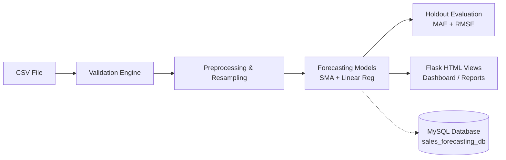

# 📊 Quick Project Documentation
## Predictive Sales Forecasting and Business Analytics System

> **B.Tech 2nd Year CSE Major Project**  
> **Tech Stack:** Python 3, Flask, Pandas, NumPy, Matplotlib, Scikit-learn, MySQL, HTML5, CSS3

---

## 1. Project Overview

A web-based platform that allows businesses to upload historical sales data, track business metrics (revenue, top products, category shares), forecast future sales using statistical and machine learning algorithms, and evaluate prediction accuracy using time-series holdout validation.

The system runs **out-of-the-box in CSV Mode** (using a built-in 600+ record retail dataset) and includes **full MySQL integration** with one-click database initialization and synchronization.

---

## 2. Technology Stack

| Technology | Purpose in Project |
| :--- | :--- |
| **Flask (Python)** | Web framework connecting backend logic to frontend HTML templates |
| **HTML5 & CSS3** | Clean, responsive user interface (cards, KPI widgets, data tables) |
| **Pandas & NumPy** | Data ingestion, schema validation, cleaning, and daily/monthly aggregations |
| **Matplotlib** | Generating trend charts and forecast plots (embedded directly as base64 images) |
| **Scikit-learn** | Linear Regression model for trend-based sales forecasting |
| **MySQL (Optional)** | Relational database to store products, sales, and forecast logs |

---

## 3. The 6 Website Pages

```
[1. Dashboard] ───> [2. Upload Data] ───> [3. Analytics] ───> [4. Forecasting] ───> [5. Evaluation] ───> [6. Reports]
```

1. **Dashboard (`/`)**: Displays 4 high-level KPI cards (Total Revenue, Units Sold, Active Products, Total Records), historical sales velocity chart, latest forecast summary, and MySQL connection badge.
2. **Upload Sales Data (`/upload`)**: Upload CSV files with automated checks for missing columns, negative numbers, and invalid dates. Shows a 15-row preview and provides sample CSV download/reset.
3. **Business Analytics (`/analytics`)**: Switch between Daily and Monthly views. Features revenue trend chart, Top 10 Best-Selling Products, category revenue share, and regional sales.
4. **Sales Forecasting (`/forecasting`)**: Select algorithm (Moving Average, Linear Regression, or Compare Both), interval, and horizon (7 to 90 periods). Generates interactive forecast plots and prediction tables.
5. **Model Evaluation (`/evaluation`)**: Evaluates accuracy using chronological holdout validation (e.g., 80% train / 20% test). Computes **MAE**, **RMSE**, and **MAPE**, declares the winning model, and explains results in simple words.
6. **Executive Reports (`/reports`)**: Consolidated audit report with printable layout (`@media print`), prediction charts, business assumptions, and CSV export.

---

## 4. Key Formulas & Algorithms

### 1. Revenue
$$\text{Revenue} = \text{Quantity} \times \text{Unit Price}$$

### 2. Moving Average Baseline (SMA)
Calculates the average of the previous $W$ periods to project forward:
$$\hat{y}_t = \frac{1}{W} \sum_{i=1}^{W} y_{t-i}$$
- **When to use:** When sales fluctuate around a steady level without a strong upward or downward slope.

### 3. Linear Regression Trend
Fits a trend line using Ordinary Least Squares ($t = \text{time index}$):
$$\hat{y}_t = m \cdot t + c$$
- **When to use:** When there is an overall growth or decline trend over time.
- **Safety Rule:** All predictions are clipped to $\ge 0$ since sales cannot be negative.

### 4. Forecast Error Metrics
- **Mean Absolute Error (MAE):** $\text{MAE} = \frac{1}{n} \sum |y_t - \hat{y}_t|$  
  *Meaning:* The average dollar amount the prediction was off by.
- **Root Mean Squared Error (RMSE):** $\text{RMSE} = \sqrt{\frac{1}{n} \sum (y_t - \hat{y}_t)^2}$  
  *Meaning:* Similar to MAE, but penalizes large errors much more heavily.
- **Mean Absolute Percentage Error (MAPE):** Percentage error relative to actual sales.

### 5. Why We Never Randomly Shuffle Time-Series Data
In standard machine learning, data is shuffled randomly. In sales forecasting, **data has a time order** (tomorrow's sales depend on today's).
Shuffling causes **Data Leakage (Lookahead Bias)** — the model peeks at future data to predict the past. We strictly train on the **earliest 80%** and test on the **latest 20%**.

---

## 5. System Architecture



### Database Schema (3 Tables)
- **`products`**: `product_id` (PK), `product_name`, `category`
- **`sales`**: `sale_id` (PK), `product_id` (FK), `sale_date`, `quantity`, `unit_price`, `region`
- **`forecasts`**: `forecast_id` (PK), `period`, `method`, `predicted_value`, `created_at`

---

## 6. Quick Start Guide (Windows)

Open **PowerShell** in the project folder:

```powershell
cd c:\Users\prani\Desktop\project.2py

# 1. Activate virtual environment
.\venv\Scripts\Activate.ps1

# 2. Run automated test suite (20 tests)
python -u test_app.py

# 3. Start web server
python app.py
```

Open your browser and visit: **`http://127.0.0.1:5000`**

*(Note: MySQL is completely optional. If MySQL is not running, the application automatically uses the local CSV file without any errors.)*

---

## 7. Top 5 Viva Questions & Simple Answers

### Q1: What does this project do?
> **Answer**: It is a web-based sales analytics and forecasting platform that takes historical sales transactions, verifies data quality, visualizes business performance, predicts future sales using Moving Average and Linear Regression, and evaluates forecast accuracy using holdout testing.

### Q2: Why is time-series data split chronologically instead of randomly shuffled?
> **Answer**: Because sales data depends on time. Randomly shuffling causes *data leakage*, where future points leak into training. To simulate realistic forecasting, we must train on older data and test on newer, unseen data.

### Q3: What is MAE in plain terms?
> **Answer**: Mean Absolute Error (MAE) is the average dollar amount by which our forecast was off from actual sales. An MAE of \$50 means on average our forecast missed real sales by \$50.

### Q4: When would Linear Regression beat Moving Average?
> **Answer**: Linear Regression performs better when there is a strong ongoing trend (consistent growth or decline), whereas Moving Average works better when sales hover around a steady average with short-term fluctuations.

### Q5: How does the system handle zero-sales days?
> **Answer**: It uses Pandas `pd.date_range()` to fill any missing calendar days with \$0 sales. This keeps the time steps evenly spaced, which is required for valid time-series calculations.

---

*Prepared for 2nd Year B.Tech CSE Project Evaluation & Viva.*
